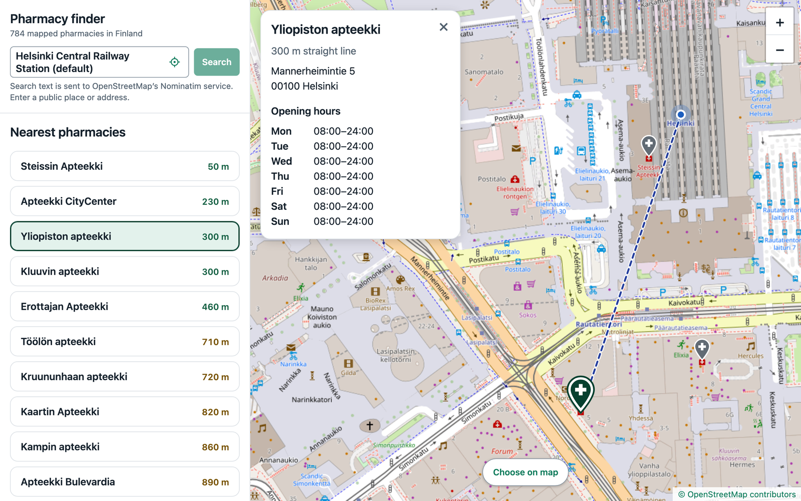
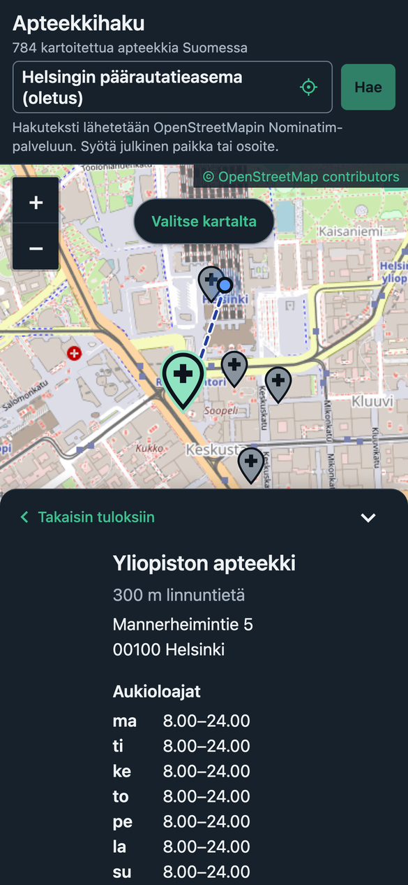

# Nearby Pharmacies · Web

Find the 20 closest mapped pharmacies to a starting point in Finland. The React app starts at
**Helsinki Central Railway Station** and ranks results by straight-line distance. Choose a row or
pin to see the pharmacy's address and weekly opening hours.

| Desktop · English                                                    | Mobile · Finnish, dark mode                                                                                                   |
| -------------------------------------------------------------------- | ----------------------------------------------------------------------------------------------------------------------------- |
|  |  |

[Watch the app journey](docs/images/journey.gif)

## Run locally

Use Node 22.12+, 24, or 26+ and the pnpm version pinned in `package.json`. The default setup
needs no account or API key.

Run `nix develop` for Node 24, Corepack, and the data and hook tools. With direnv and nix-direnv
configured, `direnv allow` loads the shell automatically. See [agent stop hooks](AGENTS.md#agent-stop-hooks)
for Betterleaks setup and the history scan.

```sh
pnpm install --frozen-lockfile
pnpm run dev
```

Open `http://127.0.0.1:5173/`. Search for a city or street address, choose **Use my location**, or
select **Choose on map** and confirm with **Search from here**. On narrow screens, open the results
drawer to see the list. The app follows the browser's preferred supported language, Finnish or
English.

## Data and services

- **Ranking runs locally** against a snapshot of 784 Finnish pharmacies. Both apps use
  unrounded haversine distance, break exact ties by OSM ID in UTF-16 order, and round the display
  only. A [shared fixture](fixtures/ranking/ranking-v1.json) checks parity with the SwiftUI app
  in `nearby-pharmacies-ios`. [Coverage and ranking decisions](docs/adr/0001-finland-coverage-and-straight-line-ranking.md)
- **Address search** sends submitted text, language, and country filter to Nominatim by default.
  Bundled Finnish and Swedish place names provide a fallback. Device fixes and map picks use
  “Your location” and “Dropped pin.” [Geocoder configuration and privacy](docs/adr/0002-geocoder-and-web-tiles.md)
- **Map tiles** come from OpenStreetMap through Leaflet. The tile provider receives requests for
  the visible map area. [Tile configuration](AGENTS.md#map-tiles)

## Repository

| Path                         | Contents                                                              |
| ---------------------------- | --------------------------------------------------------------------- |
| `src/app/`                   | App shell, page layout and state shared by the features               |
| `src/features/`              | Origin search and location, pharmacy results and details, Leaflet map |
| `src/shared/`                | Localization, coordinate math, and base styles                        |
| `src/data/`, `scripts/data/` | Bundled data, importer, and iOS sync                                  |

The [data guide](docs/data/README.md) explains how to reproduce the snapshot and verify the iOS
copies. The [design spec](docs/design/design-spec.md) defines both apps' interactions and copy.

## Checks

```sh
pnpm run style:all
pnpm run build
pnpm run test:unit
pnpm run test:ui:install
pnpm run test:ui
```

Playwright covers desktop Chromium and narrow WebKit with stubbed map tiles, geocoding, and
location. See [AGENTS.md](AGENTS.md) for test commands and configuration.

## Limitations

- Distances are straight lines. Street-address search requires a network connection.
- Address and opening-hours availability depend on the snapshot. The weekly schedule excludes
  public holidays.
- On phones, expanding the drawer can cover pins near the bottom of the initial map view.

## Development

I chose the data and services, wrote the design spec and shared fixtures, and used Claude Code
and Codex in T3 Code to implement and test both apps. I iterated on the web interactions first
and used the reviewed screens and fixtures for the iOS implementation.

## Data licence

Pharmacy, place, boundary, and address data © OpenStreetMap contributors, under the
[Open Database License](https://www.openstreetmap.org/copyright). See the
[bundled data notice](src/data/ODbL-NOTICE.txt).
