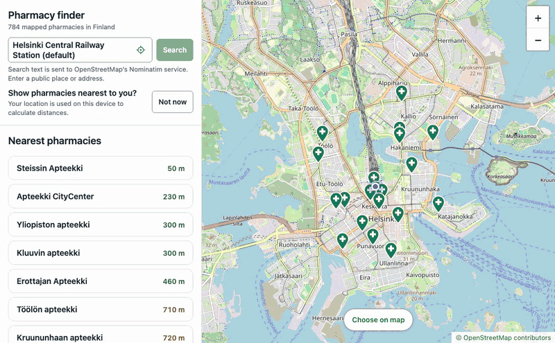
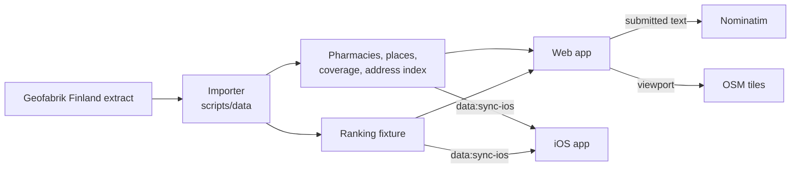

# Nearby Pharmacies · web

Find the nearest pharmacies in Finland from where you are, a searched address or any point on the
map. React and TypeScript, with a Leaflet map and pharmacy data bundled from OpenStreetMap. A
native SwiftUI version lives in the companion repository `nearby-pharmacies-ios` and shares this
repository's data, ranking rules and design spec.



| Desktop, English                                                                                  | Phone width, Finnish, dark                                                                                                           |
| ------------------------------------------------------------------------------------------------- | ------------------------------------------------------------------------------------------------------------------------------------ |
|  |  |

## Try it

```sh
pnpm install --frozen-lockfile
pnpm run dev        # http://127.0.0.1:5173/
```

Needs Node 22.12+, 24 or 26 and pnpm (the version is pinned in `package.json`). No accounts or
API keys are needed. `pnpm run build && pnpm run preview` serves the production build.

A short tour:

1. The app opens with results for **Helsinki Central Railway Station**, labelled as the default
   starting point. Steissin Apteekki, 50 m away, is first.
2. Select a row or a pin. Both highlight, the map fits the two points with a dashed straight
   line, and the details show the address and the opening hours for the week.
3. Change the starting point in one of three ways:
   - **Search** a city or street address, for example `Kauppakatu 1`, and pick the municipality
     from the matches.
   - **Use my location.** The app asks only after showing the Helsinki results, and only when you
     choose to.
   - **Choose on map**, pan under the target and press **Search from here**. A right-click or
     long-press places the point directly. The field then shows the nearest street address, such
     as "Near Yrjönkatu 9".
4. Narrow the window below 900 px for the phone layout with a results drawer. The interface
   follows the browser language: Finnish or English, with English as the fallback.

## What I decided and why

**Coverage: Finland, bundled.** The app ships a dated OpenStreetMap snapshot of the 784 mapped
pharmacies in Finland (about 34 KB gzipped) instead of calling a places API. Results are
instant, reproducible, free and work offline, and no location leaves the device for ranking. The
cost is freshness: refreshing means re-running the importer. Near a land border, and when the
starting point is outside Finland, a notice says that pharmacies in other countries are not
included. See [ADR 0001](docs/adr/0001-finland-coverage-and-straight-line-ranking.md).

**Distance: straight line, labelled as such.** Results are ranked by great-circle (haversine)
distance with the mean Earth radius 6,371,008.8 m, by unrounded distance with exact ties broken
by OSM ID. Only the display is rounded: 10 m steps under 1 km, then 0.1 km, then whole
kilometres. The distance colour is green under 500 m, amber under 1 km and red beyond. The
label always says "straight line", because a river or a motorway can make the nearest pharmacy
not the quickest to reach. Walking routes are the most obvious next step (see below).

**One ranking contract for two apps.** `fixtures/ranking/ranking-v1.json` holds origins,
expected order, distances and English and Finnish labels, including an exact tie and two
distances that round to the same label. An independent Python script computes the expected
values. Vitest here and Swift Testing in the iOS app both check against the same file, so the
apps cannot drift apart silently.

**Local first, open services only.** I preferred free, open and keyless services, and doing
on the device whatever can be done there:

| Need                | Choice                                                                                 | What leaves the browser              |
| ------------------- | -------------------------------------------------------------------------------------- | ------------------------------------ |
| Pharmacies, ranking | Bundled OSM snapshot                                                                   | Nothing                              |
| Address search      | Public Nominatim, on submit only, at most one request a second, cached for the session | The search text and language         |
| Search fallback     | 4,675 bundled Finnish and Swedish place names with fuzzy matching                      | Nothing                              |
| "Near …" labels     | Bundled OSM address index, split into 166 regional files loaded on demand              | Which coarse regional file is needed |
| Map                 | Leaflet with OpenStreetMap tiles                                                       | The visible map area                 |

The geocoder is configured at runtime in `public/geocoder.json`, so it can switch to a
self-hosted Nominatim or Photon without a rebuild. Geoapify is supported as an optional,
build-time alternative and is off by default. See
[ADR 0002](docs/adr/0002-geocoder-and-web-tiles.md) and the
[research behind it](docs/research/geocoding-and-tiles.md).

**Location only on request.** First launch shows useful results before asking for anything.
Location is offered once; the browser prompt appears only if the user accepts. A fix that
arrives after the user has chosen another starting point is ignored, and so is a late search
reply after a map pick.

**Design spec instead of mock-ups.** I started in Figma with a small component set (result
row, pin, search, hours and sheet). When the Starter plan's MCP quota ran out, a written
[design spec](docs/design/design-spec.md) with colour, type and spacing tokens, layouts, states
and the Finnish and English copy became the source of truth. The same file is kept identical in
both repositories, and the reviewed web screens became the visual reference for iOS.

**Plain components.** I would normally reach for shadcn/ui. With a handful of components, plain
React with semantic HTML and CSS custom properties kept the bundle and the dependency list small
(runtime dependencies: React and Leaflet).

**Accepted gaps in the data.** About one pharmacy in five has no opening hours in OSM, and some
have no address. The app says "Hours unavailable" or "Address unavailable" rather than guessing.
The hours view interprets 613 of the 623 `opening_hours` values in the snapshot; the rest are
shown as written.

## Architecture



| Path                        | Contents                                                                                   |
| --------------------------- | ------------------------------------------------------------------------------------------ |
| `src/app/`                  | App state (origin, selection, drawer) as a reducer, and formatting helpers                 |
| `src/origin/`               | Geocoder, bundled place fallback, nearby-address lookup, coverage notices, origin requests |
| `src/ranking/`              | Haversine distance and ranking                                                             |
| `src/hours/`                | OSM `opening_hours` interpreter for a weekly view                                          |
| `src/map/`                  | Leaflet map, pins, origin marker and the map point picker                                  |
| `src/components/`           | Result row, details, desktop details card, hours block, search                             |
| `src/i18n/`, `src/locales/` | Locale choice, distance and time formatting, English and Finnish messages                  |
| `src/data/`                 | Generated snapshot, place index, coverage geometry and manifest                            |
| `scripts/data/`             | Reproducible OSM importer (pure JavaScript PBF reader) and the iOS sync                    |
| `docs/`                     | ADRs, data documentation, research and the design spec                                     |

The importer produces byte-identical output from the same extract and records checksums in a
manifest; the iOS sync refuses to copy files that do not match it. Details are in
[docs/data/README.md](docs/data/README.md).

## Tests and checks

| Command              | What it covers                                                                                                                                           |
| -------------------- | -------------------------------------------------------------------------------------------------------------------------------------------------------- |
| `pnpm run test:unit` | 156 Vitest tests: ranking against the shared fixture, display rounding, opening hours, locale choice, geocoder requests and parsing, coverage, app state |
| `pnpm run test:ui`   | 58 Playwright journeys on desktop Chromium and narrow WebKit (7 apply to one layout only)                                                                |
| `pnpm run style:all` | Oxlint and Oxfmt                                                                                                                                         |
| `pnpm run build`     | Type check and production build                                                                                                                          |

Run `pnpm run test:ui:install` once to download the browsers. The browser journeys cover
both languages, granted location in Tampere, denied and timed-out location, ambiguous address
matches, the bundled place fallback, a late geocoder reply after a map pick, row and pin
selection, keyboard-only use, coverage notices and a 320 px wide screen. They stub location,
the geocoder and the map tiles, so they never contact a live service.

## Known limitations

- Distances are straight lines, not walking routes.
- Street-address search needs the online geocoder; offline, only place names are found.
- The opening hours ignore public holidays, and there is no "open now" badge yet.
- The public Nominatim and OSM tile servers are donated capacity with usage policies. A busier
  deployment should move to its own instance or a commercial provider, which is a configuration
  change.
- On phone widths the first map fit uses the collapsed drawer, so expanding the list can cover
  pins near the bottom of the map.

## What I would do next

- **Walking routes.** Rank, or at least show, walking distance, or link the selected pharmacy to
  a walking route in a maps app as a cheap first step.
- **A small backend.** The ranking, hours and address logic are written twice, in TypeScript and
  Swift, held together by shared fixtures. A shared API would remove that duplication at the cost
  of hosting and of sending locations to a server. I scoped it out for this version.
- **A privacy setting** that turns the online geocoder and map tiles off, leaving the bundled
  data only.
- **Remember the last starting point** between visits.
- **Code structure.** Group the code by feature (vertical slices), and review hooks for
  unnecessary `useMemo` and `useCallback`.
- **Smaller polish:** a favicon, an "open now" badge, and checking whether search results can be
  localised further.

## How I built it

I built both apps with AI coding agents (Claude Code and Codex), orchestrated in T3 Code, which
also provided the shared browser and simulator previews used for review. The interesting part was
keeping control of the result:

- I wrote a product plan and a high-level task list first, choosing the services, dependencies
  and data sources myself, then split the plan into tasks small enough to hand to an agent and
  review.
- Each repository got agent instructions (`AGENTS.md`), style checks wired to an agent stop hook,
  and unit and UI tests early on, so an agent could verify its own work before handing it back.
- Because there were two apps, I started with the data research, the ADRs and the design spec,
  built the web app first, iterated on it, folded the changes back into the spec, and then built
  the iOS app against the same spec and fixtures.
- With good tests and hooks, the agents produced working UI with few issues; most iteration went
  into interaction details and different screen sizes.

I followed "make it work, make it nice, make it fast" and kept the visual polish deliberate but
limited, spending the time on behaviour, accessibility, privacy and tests instead.

## Data licence

Pharmacy, place, boundary and address data © OpenStreetMap contributors, available under the
[Open Database License](https://www.openstreetmap.org/copyright). The derived files are published
under the same licence; see `src/data/ODbL-NOTICE.txt`.
